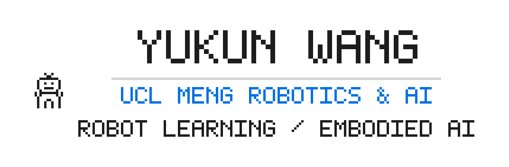

  <picture>
    <source media="(prefers-color-scheme: dark)" srcset="assets/banner.png">
    
  </picture>

UCL MEng Robotics & AI · Researcher, [UCL Humanoid Robotics Lab](https://ucl-humanoid.github.io/) · previously Tsinghua IIIS × Zhongguancun Academy and UBTECH.

UCL Robotics & AI 本硕连读 · UCL Humanoid Robotics Lab Researcher · 曾在清华交叉信息研究院 × 中关村学院、优必选从事具身智能研究。

**News**
- **2026.11** · AHEADance (co-first author) is under review at IEEE T-RL · [arXiv](https://arxiv.org/abs/2611.13370) · [project page](https://ihcr.github.io/AHEADance/) · [video](https://youtu.be/WqwX6balBUI)
- **2026.10** · AHEADance dances on a real Unitree G1 to live music heard through a microphone

**Paper**
- **AHEADance: Anticipatory Humanoid Dance from Streaming Audio** · T. Peng\*, **Y. Wang\***, L. Bao, Y. Jia, C. Zhou · IEEE T-RL, under review · [arXiv:2611.13370](https://arxiv.org/abs/2611.13370) · \*co-first authors

**Internships**
- **UBTECH** (2026) · VLA intern: NVIDIA GR00T N1.7 post-training, RECAP policy flywheel, training-time RTC · [demos](https://lbtwyk.github.io/?lang=en#ubtech)
- **Tsinghua IIIS × Zhongguancun Academy** (2025) · OpenVLA sim–real co-training with PPO, Diffusion Policy on a real Franka · [demos](https://lbtwyk.github.io/?lang=en#tsinghua)

`Humanoid Motion Generation` `Whole-Body Control` `VLA` `Diffusion Policy` `Reinforcement Learning` `Sim2Real` `Unitree G1` `GR00T` `Isaac Sim`

[Website](https://lbtwyk.github.io/) · [Email](mailto:lambert.wang.23@ucl.ac.uk) · [LinkedIn](https://www.linkedin.com/in/yukun-wang-024120297/)
