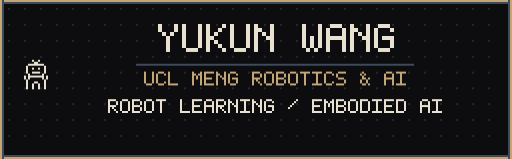

  

I'm a fourth-year MEng Robotics & AI student at UCL and a Researcher in the [UCL Humanoid Robotics Lab](https://ucl-humanoid.github.io/). I work on humanoid motion generation and on robot policies that keep improving from their own experience.

UCL Robotics & AI 本硕连读四年级，在 UCL Humanoid Robotics Lab 担任 Researcher，研究人形机器人动作生成，以及让机器人策略从自身经验中持续改进。

- **AHEADance** · a humanoid that dances to live music in real time on a Unitree G1 · [demo](https://lbtwyk.github.io/#aheadance)
- **UBTECH** (2026) · robots that make their own training data and learn from their own mistakes · [demos](https://lbtwyk.github.io/#ubtech)
- **Tsinghua IIIS × Zhongguancun Academy** (2025) · learning manipulation from real and simulated data · [demos](https://lbtwyk.github.io/#tsinghua)

  <a href="https://lbtwyk.github.io/"> Website</a>
  &nbsp;·&nbsp;
  <a href="mailto:lambert.wang.23@ucl.ac.uk"> Email</a>
  &nbsp;·&nbsp;
  <a href="https://www.linkedin.com/in/yukun-wang-024120297/"> LinkedIn</a>

